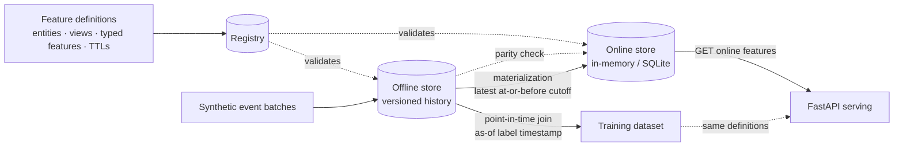

# Feature Store

 

An enterprise-grade reference implementation of a **feature store**: a
validated feature registry, a versioned **offline store** with
**point-in-time-correct joins**, a low-latency **online store**,
batch **materialization**, **offline/online parity checks**, and a
FastAPI serving layer.

All data is **synthetic** (invented customers and products on a fixed
timeline, generated deterministically in code) and all code is
original — a clean-room build suitable for studying the architecture
without any real-world system behind it.

## The problem

Two failure modes quietly destroy production ML:

1. **Training/serving skew.** Training computes features one way
   (a SQL job over a warehouse), serving computes them another way
   (hand-written code in the request path). The definitions drift, and
   the model served is not the model that was validated.
2. **Point-in-time leakage.** A training row is labelled at a moment in
   time, but a naive join attaches the *latest* feature values —
   including values recorded **after** the label moment. The model
   learns from the future, looks brilliant offline, and fails live,
   because at serving time the future has not happened yet.

A feature store fixes both structurally: one registry defines every
feature once; training joins history **as of** each label timestamp;
serving returns the latest materialized value of the *same* definition.

## Architecture



Full design notes — including the point-in-time join algorithm:
[docs/architecture.md](docs/architecture.md).

## The demo feature model

| View | Entity | Features | TTL |
|---|---|---|---|
| `customer_activity` | customer | `orders_7d` int, `spend_7d` float, `sessions_7d` int | 30 days |
| `customer_profile` | customer | `segment` string, `tenure_days` int, `is_premium` bool | none |
| `product_popularity` | product | `views_24h` int, `purchases_24h` int, `avg_rating` float | 7 days |

## Quickstart

Requires Python 3.11+.

```bash
pip install -r requirements.txt
pip install -e .

# End-to-end demo: the leakage case, a training dataset,
# materialization, serving, and a parity check
python examples/run_demo.py
# equivalently: feature-store demo
```

Use it as a library:

```python
from datetime import datetime, timezone
from feature_store import (
    FeatureRegistry, OfflineStore, InMemoryOnlineStore,
    Materializer, get_historical_features, EntityRow,
)
from feature_store.synthetic import build_demo_registry, generate_records

registry = build_demo_registry()
offline = OfflineStore(registry)
for view, records in generate_records().items():
    offline.write(view, records)

# Training: point-in-time-correct — values as of each label moment.
dataset = get_historical_features(
    registry, offline,
    [EntityRow("CUST-001", datetime(2024, 1, 10, 12, tzinfo=timezone.utc), label=1)],
    ["customer_activity", "customer_profile"],
)

# Serving: materialize latest values, then read them back online.
online = InMemoryOnlineStore()
Materializer(registry, offline, online).materialize(
    None, datetime(2024, 1, 22, tzinfo=timezone.utc)
)
served = online.get_features(registry.get_view("customer_activity"), "CUST-001")
```

Run the serving API:

```bash
feature-store serve --port 8000
# POST /online-features      {"feature_view": "customer_activity", "entity_ids": ["CUST-001"]}
# POST /historical-dataset   {"feature_views": [...], "entity_rows": [{...}]}
# POST /materialize          {"cutoff": "2024-01-22T00:00:00+00:00"}
# GET  /consistency/customer_activity?at=2024-01-22T00:00:00+00:00
```

Docker:

```bash
docker build -t feature-store .
docker run -p 8000:8000 feature-store
```

## Key design decisions & trade-offs

- **One registry, both paths.** Offline writes, online writes, joins,
  and serving all validate against the same typed definitions. Skew
  between duplicated definitions is impossible by construction.
- **As-of semantics everywhere.** The training join and materialization
  use the *same* rule — latest record with `event_timestamp <= t`,
  TTL-checked at `t` — so "what the model trained on" and "what it is
  served" differ only in the timestamp, never in the logic.
- **Append-only history with two timestamps.** `event_timestamp` says
  when a value became true; `created_timestamp` records when the store
  learned it. Late-arriving corrections share an event time, and the
  later-created record wins — history is reproducible per batch version.
- **TTL enforced at read, not delete.** Expired values join/serve as
  `None` but stay in the stores: a parity check or a backfill can still
  see them, and "missing" is distinguishable from "never existed".
- **The online store rejects older writes.** A delayed batch can never
  resurrect stale values over a fresher row, regardless of arrival order.
- **Backends behind interfaces.** The online store ships in-memory and
  SQLite implementations with identical semantics; a Redis/DynamoDB
  backend is a new class, not a refactor. The offline store is an
  in-memory columnar-lite table — the join algorithm, not the storage
  engine, is the point; a warehouse backend slots behind the same API.

## What it demonstrates

- Feature definitions as contracts: entities, feature views, typed
  features, TTLs, and registry validation that fails fast.
- Point-in-time joins with binary-search as-of lookups, proven by tests
  that a future value is *never* joined.
- Training/serving consistency: materialization + a parity checker that
  catches tampered or missing online values field-by-field.
- Deterministic synthetic data — same seed, same dataset, in CI and demos.

## Testing

```bash
PYTHONPATH=src python -m pytest -q   # or: make test
```

The suite covers registry validation, offline write validation and
versioning, point-in-time correctness (at-or-before, exact match,
future exclusion, TTL boundary, late corrections), both online
backends, materialization latest-value semantics and idempotency,
parity detection, and the HTTP API.

CI: [docs/github-actions-ci.yml](docs/github-actions-ci.yml) is a
ready-to-use GitHub Actions workflow (move it to
`.github/workflows/ci.yml` to activate).

## Limitations

- Single-entity views (one join key per view); composite entities are
  a documented extension, not implemented.
- The offline store is in-memory; very large histories belong in a
  warehouse/lakehouse table behind the same interface.
- No streaming materialization — batch only, on a caller-driven cutoff.
- TTL checks use event time; ingestion-time TTLs (freshness of the
  pipeline itself) would be a second, separate policy.

## License

MIT — see [LICENSE](LICENSE).
