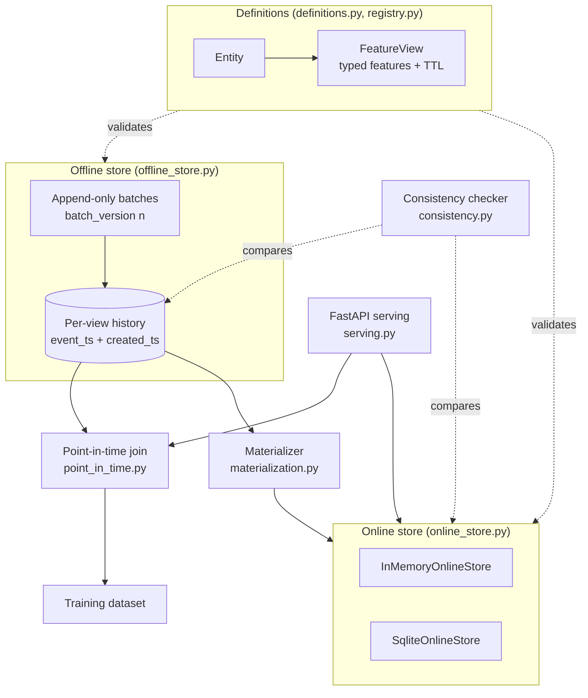

# Architecture — Feature Store

## Problem framing

A feature store exists to make one guarantee in two directions:

- **Backwards (training):** every feature on a training row is the value
  that was true at the row's label timestamp — no earlier staleness than
  the data itself, and *never* anything from the future.
- **Forwards (serving):** the value a model sees at prediction time is
  produced by the same definition, from the same history, as the values
  it trained on.

Everything in this design — the shared registry, the two-timestamp
offline history, the single as-of rule reused by the join and by
materialization — serves that guarantee.

## Components

### Registry (`registry.py`, `definitions.py`)

Entities and feature views, validated at registration: entities must
exist before views reference them, feature names are unique per view,
TTLs are non-negative. Definitions are frozen dataclasses — a
registered view cannot be mutated, so history written under it stays
interpretable forever. Values are validated on *every* write (offline
and online) against the view's typed schema; `bool` is explicitly not
an `int`, and ints widen to floats for float features so offline and
online representations compare equal.

### Offline store (`offline_store.py`)

Append-only, per-view tables of `FeatureRecord`s. Each write batch gets
a monotonically increasing `batch_version`. Records carry two
timestamps:

- `event_timestamp` — when the value became true in the world. This is
  the timestamp as-of semantics run on.
- `created_timestamp` — when the store learned the value. A correction
  to last Tuesday's aggregate arrives today: old event time, new
  created time.

As-of order within an entity is `(event_timestamp, created_timestamp,
batch_version)` — for two records about the same moment, the
later-learned one is the truth.

### The point-in-time join (`point_in_time.py`)

**Input:** a *spine* of entity rows — `(entity_id, event_timestamp,
label?)` — and a list of feature views.
**Output:** one row per spine row, with `<view>__<feature>` columns.

Algorithm, per view:

1. Group the view's history by entity and sort each group into as-of
   order once — O(R log R) for R records.
2. For each spine row at time `t`, binary-search the entity's timestamp
   list for the rightmost record with `event_timestamp <= t`
   (`bisect_right(timestamps, t) - 1`) — O(log R) per lookup.
3. Apply the TTL: if `t - record.event_timestamp > view.ttl`, the value
   had already gone stale at the label moment, so every feature from
   that record joins as `None`. (Age exactly equal to the TTL is still
   fresh.)
4. Copy the record's values into the output columns; features missing
   from that record join as `None`.

Total cost is O(R log R + S log R) for S spine rows, versus O(S × R)
for the naive scan-per-row join — and, more importantly than speed, the
rule is stated in exactly one place.

Why this prevents leakage: step 2's predicate is `<= t`, full stop.
There is no code path by which a record with `event_timestamp > t` can
be selected, which the test suite proves directly (a label on Jan 9
never sees the Jan 10 record, even though it is the "latest" in the
table).

**Known simplification:** the join resolves corrections purely by
as-of order, including corrections created *after* the label timestamp.
A stricter "as-known-at" join would also filter
`created_timestamp <= training_run_time`. That is the right choice when
auditing what a specific past training run could have seen; the
event-time rule is the right choice for building the best current
dataset. The two-timestamp model keeps both expressible.

### Online store (`online_store.py`)

One row per `(view, entity)`: the latest values plus their event
timestamp. Two backends (`InMemoryOnlineStore`, `SqliteOnlineStore`)
sit behind one interface with identical semantics, enforced by running
the same test suite against both:

- `upsert` refuses a write whose event timestamp is older than the
  stored row's — arrival order can never resurrect stale values.
- TTL is checked at read time against a caller-supplied `at`
  (defaulting to wall clock) so tests are deterministic and backfills
  can ask "what would serving have returned then?".
- `get_row` bypasses TTL deliberately: the parity checker must see
  expired-but-present rows to distinguish "stale" from "missing".

### Materialization (`materialization.py`)

The batch bridge: for a cutoff time, per entity, take the latest
offline record at-or-before the cutoff (the same selection rule as the
join, steps 2–3 minus the per-row spine) and upsert it online. Runs are
idempotent in effect — re-running with the same cutoff leaves the same
online state — and a run can never move the online store *backwards*,
because the upsert freshness rule rejects older rows.

### Parity checks (`consistency.py`)

For a check time `at`, recompute each entity's expected latest values
from the offline store and compare field-by-field with the online rows.
Reports distinguish three states per entity: matching, field mismatches
(with both values), and missing online. This is the operational alarm
for materialization lag, dropped batches, and out-of-band writes.

### Serving (`serving.py`)

FastAPI surface over the same objects — no re-implementation:

| Endpoint | Path |
|---|---|
| `GET /health`, `GET /feature-views[/{name}]` | discovery |
| `POST /online-features` | online-store reads for a batch of entities |
| `POST /historical-dataset` | the point-in-time join, over HTTP |
| `POST /materialize` | run materialization to a cutoff |
| `GET /consistency/{view}` | parity report for one view |

## Design trade-offs

- **In-memory offline store.** The join algorithm and the history
  model are the substance; a Parquet/warehouse backend would implement
  the same `records_for` contract. Keeping it in-memory makes the
  semantics testable in milliseconds with zero infrastructure.
- **Batch, not streaming, materialization.** Batch is simpler to make
  idempotent and reproducible; streaming freshness is an operational
  upgrade that does not change any definition or the as-of rule.
- **TTL at read time.** Deleting expired data would destroy the
  evidence parity checks and backfills need. Expiry is a *serving*
  decision, so it lives at the read boundary.
- **Single-entity views.** One join key per view covers the large
  majority of production feature views and keeps the join honest;
  composite keys are an extension of `EntityRow`, not a redesign.
